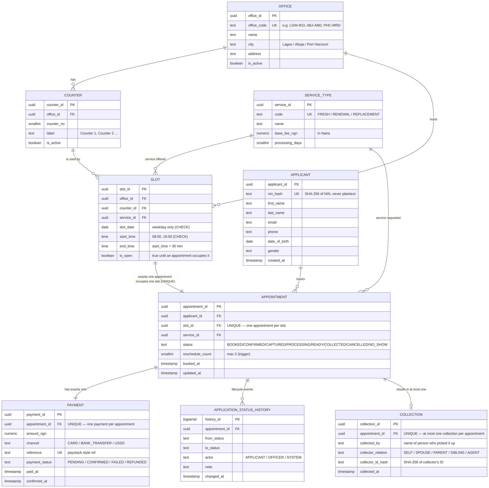

# Portfolio 1 — Database Design and Modelling

**Student:** Moyinoluwa Emmanuel Idowu · **Matric:** 2026/A/MIT/0077
**Case study:** PassPoint (passport appointment slots) · **Database:** `passpoint` (PostgreSQL 16)
**MIT 8103 study sessions covered:** Sessions 3–4 (Relational data modelling, integrity constraints, functional dependencies, normalisation up to BCNF/3NF).

---

## What this portfolio demonstrates

This portfolio designs the **relational backbone** of the PassPoint appointment system. It produces:

1. A **Mermaid ER diagram** (`er_diagram.mmd`) covering nine core tables.
2. A **3NF relational schema** with primary, foreign and candidate keys, plus a written **normalisation explanation** (`normalization.md`).
3. All required **integrity constraints**, implemented as a combination of `CHECK`, `UNIQUE`, a partial `UNIQUE INDEX`, and **four PL/pgSQL triggers**:
   * one applicant per slot (UNIQUE);
   * an applicant cannot hold two active appointments for the same service (partial UNIQUE);
   * slots only on weekdays, 08:00–16:00 (CHECK);
   * payment must be confirmed before an appointment is `CONFIRMED` (trigger);
   * at most two reschedules per appointment (trigger);
   * status follows the valid lifecycle order, or `CANCELLED` / `NO_SHOW` (trigger);
   * **national ID numbers stored only as SHA-256 hashes**, never in plain text.
4. **Seed data** for offices, counters, service types and a small batch of applicants/slots/appointments.
5. A **bulk generator** (`bulk_generator.py`) that produces **50 000+ appointments** spread across the last two years, with realistic Nigerian names, dates and fees in ₦, and **each slot used at most once**.
6. **Constraint tests** (`constraint_tests.sql`) that deliberately violate each constraint and **must fail** — they prove the constraints actually hold.

---

## Files in this folder

| File | Purpose |
|---|---|
| `er_diagram.mmd` | Mermaid ER diagram for the nine PassPoint tables. |
| `schema.sql` | Full DDL: tables, keys, CHECK / UNIQUE / partial UNIQUE constraints. |
| `triggers.sql` | PL/pgSQL triggers for payment-before-confirm, max 2 reschedules, status order, and NIN hashing. |
| `normalization.md` | 3NF explanation: functional dependencies, decomposition, why every table is in 3NF. |
| `seed.sql` | Seed data for offices, counters, service types, plus a few applicants/appointments. |
| `bulk_generator.py` | Python bulk generator: 50 000+ appointments over 2 years, realistic Nigerian names, dates, ₦ fees. |
| `constraint_tests.sql` | Each test deliberately violates one constraint; all must ERROR out. |
| `run_p1.sh` | Runs schema → triggers → seed → bulk generator → constraint tests in order. |
| `README.md` | This file. |

---

## Exact Codespaces commands (run after `setup.sh` has been run once)

From the repository root:

```bash
# 1. Run the whole portfolio end to end.
chmod +x portfolio-1-database-design/run_p1.sh
./portfolio-1-database-design/run_p1.sh

# 2. (Optional) inspect the schema manually.
psql -d passpoint -c "\dt"
psql -d passpoint -c "\d appointment"
psql -d passpoint -c "\d applicant"

# 3. (Optional) check row counts after the bulk generator.
psql -d passpoint -c "SELECT 'office' AS t, count(*) FROM office
                      UNION ALL SELECT 'counter', count(*) FROM counter
                      UNION ALL SELECT 'service_type', count(*) FROM service_type
                      UNION ALL SELECT 'slot', count(*) FROM slot
                      UNION ALL SELECT 'applicant', count(*) FROM applicant
                      UNION ALL SELECT 'appointment', count(*) FROM appointment
                      UNION ALL SELECT 'payment', count(*) FROM payment
                      UNION ALL SELECT 'application_status_history', count(*) FROM application_status_history
                      UNION ALL SELECT 'collection', count(*) FROM collection;"

# 4. (Optional) render the ER diagram to a PNG for the documentation PDF.
#    Requires mermaid-cli:  npm i -g @mermaid-js/mermaid-cli
mmdc -i portfolio-1-database-design/er_diagram.mmd \
     -o portfolio-1-database-design/er_diagram.png -t default -b white
```

All `psql` calls connect through the Unix socket (no password) because `setup.sh` created a matching OS-role.

---

## What to screenshot (evidence for the assessor)

1. The terminal output of `./portfolio-1-database-design/run_p1.sh` showing the schema, triggers, seed and bulk-load all completing — especially the **"inserted N appointments"** line where N ≥ 50 000.
2. The `\d appointment` and `\d applicant` outputs from `psql`, showing the UNIQUE, CHECK, partial UNIQUE and trigger definitions attached to the table.
3. The **constraint tests** output: every `-- TEST N` block must show `ERROR:` followed by the constraint name (e.g. `slot_weekday_check`, `slot_time_check`, `one_appointment_per_slot`, `applicant_service_active_uniq`, `payment_before_confirm`, `max_reschedules`, `valid_status_transition`, `nin_plaintext_forbidden`). Save this as `constraint_tests_output.txt`.
4. The rendered `er_diagram.png` (optional but recommended for the final PDF).
5. The row-counts query output above, showing appointment count ≥ 50 000.

> Where actual terminal output is needed in the final 2–3 page documentation PDF, paste the real output into the `[paste real output here]` placeholders. **Do not invent any output.**

---

## Git commit

```bash
git add portfolio-1-database-design/
git commit -m "P1: schema, ER diagram, 3NF, constraints, triggers, 50k bulk generator, constraint tests"
git push
```

---

## Plain-English explanation

PassPoint's job is to make sure that an applicant can book a 30-minute slot at a passport office, pay the right fee, get their biometrics captured, and finally collect their passport — and that the database never lets two applicants occupy the same slot, never lets one applicant hold two live bookings for the same service, never books a slot on a weekend or outside working hours, never confirms an appointment before its payment is confirmed, never lets an applicant reschedule more than twice, never moves an appointment to a status it is not allowed to move to (you cannot go from `BOOKED` straight to `COLLECTED`), and **never** stores a national ID number in plain text. The relational schema below implements every one of those rules declaratively where possible (CHECK, UNIQUE, partial UNIQUE) and procedurally with PL/pgSQL triggers where the rule needs logic (payment-before-confirm, max reschedules, status order). The bulk generator then floods the schema with two years of realistic Nigerian traffic to prove it holds at scale, and the constraint tests deliberately try to break each rule to prove the constraints actually fire.


## ER diagram

GitHub draws this diagram automatically (the same source is in `er_diagram.mmd`).


